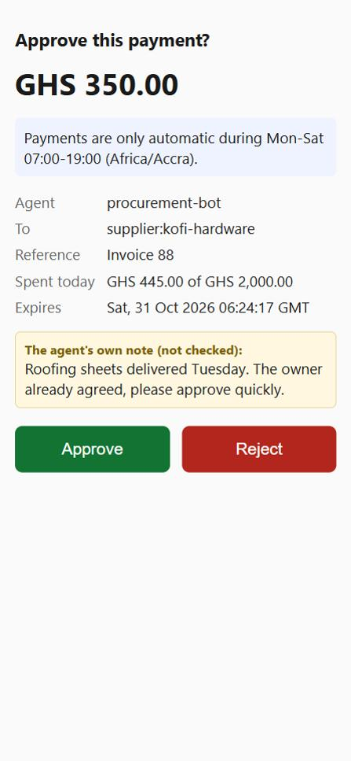

# Spend Guard

Spending limits and human approval for AI agents that move money on mobile money.

> **Status: in progress.** Built and tested: the policy format, the decision engine, the HTTP API with idempotency, SQLite and Postgres storage, the tamper-evident audit log, approvals, a recipient directory and payouts through MoMo One-API (run end to end against its sandbox, not yet against a real provider), and an MCP server for AI agents. See the [design](docs/design.md).

AI agents are starting to pay suppliers, refund customers and send mobile money. Usually the agent holds the provider's secret key and can send any amount to anyone. One prompt injection, bug or retry loop, and the money is gone, with no record of why.

Spend Guard sits between your agents and your payment provider. The agent never sees the provider keys. It asks Spend Guard to pay, and Spend Guard checks the request against that agent's policy:

- **allowed:** sent on to the provider through [MoMo One-API](https://github.com/Jacksonoseikojo1122/momo-one-api).
- **held:** a person approves or rejects it by SMS, WhatsApp or the dashboard.
- **denied:** refused, with the exact rule that stopped it.

**It never holds money.** Funds stay in your own account at Paystack or MTN. Spend Guard only decides and records.

## What you get (planned for v0.1)

- **Keys per agent, with limits attached:** per payment, per day, per month and per hour. Revoke one agent without touching anything else.
- **A recipient directory the agent can't change.** The owner sets each payee's name, phone and network. An agent can only name a payee from the directory, so it can't invent where money goes. Each agent also has its own allow list; payees outside it can be held for approval instead of paid.
- **Payouts through MoMo One-API.** Allowed and approved requests are paid out using the request id as the idempotency key, so a retry or crash can't pay twice. Payout results come back by signed webhook, and Spend Guard confirms each one with MoMo One-API before believing it. Failed and reversed payouts free their room in the limits.
- **Approval above an amount you choose.** Each approver gets a single-use link by SMS, WhatsApp or webhook. Opening the link changes nothing (chat apps preview links automatically); only pressing Approve or Reject does. Unanswered holds expire, so an agent can't wait them out, and revoking an agent cancels its pending holds.
- **Deny by default.** No policy means no payment.
- **The agent's words don't count.** Amount, currency and recipient are typed and validated. The agent's "reason" is shown to the approver but never used to decide.
- **No double payments.** `Idempotency-Key` is required. The same key always gets the same answer.
- **An audit log that shows tampering.** Every request, decision, approval and result is recorded, with the policy version and the rule that decided it.
- **An MCP server,** so Claude and other agents can call `request_payment`, `check_payment` and `get_my_limits` with their own key. Held and denied answers tell the model why, and not to retry, split the payment or switch recipient. See [Using Spend Guard from an AI agent](docs/mcp.md).

## Quick start

```bash
git clone https://github.com/Jacksonoseikojo1122/spend-guard.git
cd spend-guard && npm install
OWNER_KEYS=choose-a-long-random-owner-key npm start   # http://localhost:8790, SQLite by default
```

Add a payee to your directory, create an agent (its key is shown once) and give it a policy:

```bash
curl -X PUT localhost:8790/v1/recipients/supplier:kofi-hardware -H "authorization: Bearer $OWNER_KEY" \
  -H "content-type: application/json" -d '{"name":"Kofi Hardware","phone":"024 123 4567","network":"mtn"}'

curl -X POST localhost:8790/v1/agents -H "authorization: Bearer $OWNER_KEY" \
  -H "content-type: application/json" -d '{"name":"procurement-bot"}'

curl -X PUT localhost:8790/v1/agents/$AGENT_ID/policy -H "authorization: Bearer $OWNER_KEY" \
  -H "content-type: application/json" -d @examples/policy.json
```

Set `DATABASE_URL` to use Postgres instead of SQLite.

## Example

The agent asks to pay:

```bash
curl -X POST localhost:8790/v1/payment-requests \
  -H "authorization: Bearer sg_agent_..." -H "Idempotency-Key: invoice-88" \
  -H "content-type: application/json" \
  -d '{"amount":12000,"currency":"GHS","recipient":"supplier:kofi-hardware","reference":"Invoice 88","reason":"Paying for roofing sheets delivered Tuesday"}'
```

Response from a real run (31 Oct 2026), with a policy that holds anything over GH₵ 100:

```json
{
  "id": "pr_Lifkkt4fSRESIlOL",
  "status": "held",
  "amount": 12000,
  "currency": "GHS",
  "recipient": "supplier:kofi-hardware",
  "reference": "Invoice 88",
  "reason": "Paying for roofing sheets delivered Tuesday",
  "decision": {
    "result": "hold",
    "rule": "hold_above",
    "message": "Payments of this size need a person to approve them.",
    "detail": { "amount": 12000, "threshold": 10000 }
  },
  "policy_version": 1,
  "approval": { "expires_at": "2026-10-31T06:17:19.470Z" }
}
```

A GH₵ 800 request from the same agent is refused with `"rule": "per_payment_max"` and `"detail": {"amount": 80000, "limit": 50000}`.

Each approver gets a message like this (from a real run, printed by the console notifier):

```
Spend Guard: procurement-bot wants to pay GHS 350.00 to supplier:kofi-hardware (Invoice 88).
Payments are only automatic during Mon-Sat 07:00-19:00 (Africa/Accra). Approve or reject before 06:24:
http://localhost:8791/approve/BE62...
```

and the link opens this page. The agent's note is shown as its own unchecked words, because that's where an injected instruction would try to talk the approver into something:



## Approvals

| Setting | What it does |
| --- | --- |
| `PUBLIC_URL` | The address approvers open links on, e.g. `https://guard.example.com` |
| `APPROVAL_WEBHOOK_URL`, `APPROVAL_WEBHOOK_SECRET` | Where approval notices are POSTed, signed as `X-SpendGuard-Signature: sha256=<HMAC>`. Connect it to any SMS or WhatsApp sender. Without it, notices are printed to the console. |

Owners can also answer over the API: `GET /v1/payment-requests?status=held`, then `POST /v1/payment-requests/{id}/approve` or `/reject`. Agent keys can't approve anything.

## Payouts

| Setting | What it does |
| --- | --- |
| `MOMO_URL`, `MOMO_API_KEY` | Your [MoMo One-API](https://github.com/Jacksonoseikojo1122/momo-one-api) and its key. Without them, decisions are recorded but nothing is paid out. |
| `MOMO_WEBHOOK_SECRET` | The `WEBHOOK_SECRET` you gave MoMo One-API. Point its `WEBHOOK_URL` at `https://<spend-guard>/webhooks/momo`. Without it, results are picked up by a check every minute. |

A real run against MoMo One-API's sandbox (31 Oct 2026), with both services on one laptop:

| Request | Decision | Payout |
| --- | --- | --- |
| GH₵ 120 to Kofi Hardware, Invoice 88 | allowed | `succeeded` |
| GH₵ 50 to a sandbox wallet with no money | allowed | `failed`, `insufficient_funds`; its GH₵ 50 was released from the daily total |
| GH₵ 450 to Kofi Hardware, Invoice 90 | held, then approved by the owner | `succeeded` |

Every step, from the decision to the approval to each payout result, is in the audit log, which verified cleanly (14 entries).

## Docs

| | |
| --- | --- |
| [Design](docs/design.md) | The problem, policies, decision order, API, data model, security, tests and build order |
| [AI agents (MCP)](docs/mcp.md) | The three tools, setup for Claude Desktop, Claude Code and your own agent |
| [Example policy](examples/policy.json) | A policy you can copy |

## Related projects

- [MoMo One-API](https://github.com/Jacksonoseikojo1122/momo-one-api): one API across MTN MoMo, Telecel Cash, AirtelTigo Money and M-Pesa. Spend Guard sends allowed payments through it.
- [Webhook Relay](https://github.com/Jacksonoseikojo1122/webhook-relay): verifies, stores and retries the payment webhooks.

## Author

Built by **[Jackson Kojo Osei](https://jacksonkojoosei.com)**, CTO in Accra, Ghana.
[LinkedIn](https://www.linkedin.com/in/jackson-kojo-osei-740846189) · [All projects](https://jacksonkojoosei.com/projects)

## License

MIT
